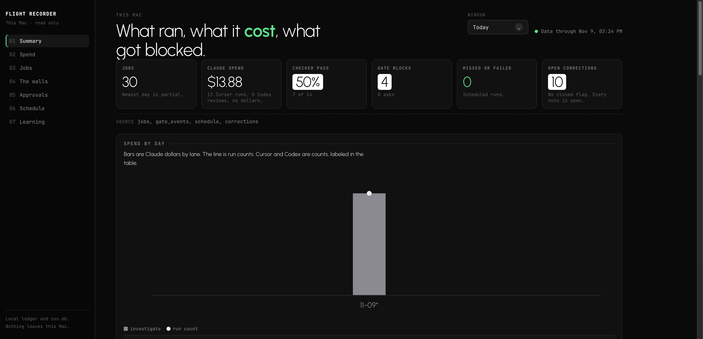
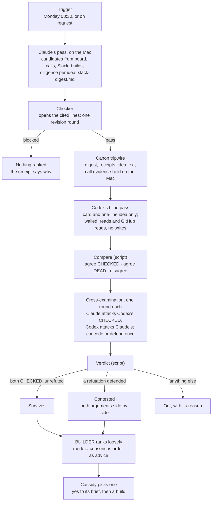

# cos-kit

> **Five bots, one Mac, nothing unapproved.** Cassidy's chief-of-staff system. Five Grok bots split the work: a Chief he talks to, and four specialists for his clock, the board, engineering builds and the bots themselves. His Mac does everything that touches the repos, the board, transcripts or data, through one front desk and its own clock. It owns what's waiting on him until it's closed. Nothing leaves the team, merges, or changes shared state without his yes on that exact action, except the two kinds of work he pre-approved.


<p align="center">
  <picture>
    <source media="(prefers-color-scheme: dark)" srcset="docs/images/architecture-dark.svg">
    
  </picture>
  <br>
  <em>How the parts connect. Cassidy asks the Chief. The Chief hands work to the four specialists, and runs <code>cos-run</code> on the Mac only after his tap. The Mac's clock runs the scheduled jobs and pushes each receipt to the bot that owns it.</em>
</p>

> **New agent?** Start with [HANDOFF.md](HANDOFF.md), the cold-start note: the rules, where everything lives, how to change it safely, and what's open.

---

## Table of Contents

1. [What Problem Does This Solve?](#what-problem-does-this-solve)
2. [The Bots](#the-bots)
3. [Who Does What](#who-does-what)
4. [What's Waiting on Cassidy](#whats-waiting-on-cassidy)
5. [The Mac](#the-mac)
6. [The Flight Recorder](#the-flight-recorder)
7. [The Week](#the-week)
8. [How BUILDER Picks a Build](#how-builder-picks-a-build)
9. [How a Write Gets Approved](#how-a-write-gets-approved)
10. [The Walls](#the-walls)
11. [How It Learns](#how-it-learns)
12. [Rules That Come First](#rules-that-come-first)
13. [Install and Change](#install-and-change)
14. [Project Structure](#project-structure)

---

## What Problem Does This Solve?

Cassidy enforces the data org's board and roadmap, owns his own builds, and runs a short-handed team's operating rhythm. A single assistant chat can't hold all of that. It forgets, it acts on stale facts, and it has access it shouldn't use.

This kit splits the work by owner and puts walls where mistakes are expensive:

| Need | How the kit meets it |
| --- | --- |
|  | Cassidy talks only to the Chief. It's the only bot that runs commands or writes anywhere, so every approval happens in one chat |
|  | Review requests, mentions and finished cards are owned until GitHub shows them closed, not just flagged |
|  | Owners, dates, RAGB and status are fetched from their system of record every time, never remembered |
|  | STEWARD runs the repo's own `make` targets daily and stages writes for his yes |
|  | Builds are verified before and after, by an independent verifier and a second model |
|  | KEEPER turns repeated mistakes into checks and tested fixes |

---

## The Bots

| Bot | Job | Runs | Never | Status |
| --- | --- | --- | --- | --- |
|  | The only bot Cassidy talks to, and the only one that runs commands. Restates each ask as a brief, picks the lane, gets his yes, reports finished jobs. | When he messages it | Sends, merges, or changes a sheet or calendar without his yes |  |
|  | The morning brief, with follow-up drafts from yesterday's calls. Owns the obligations ledger until each item is closed. | Weekdays 06:30, and every two hours | Sends anything, or runs a command |  |
|  | The board (Project 1) and the Data Roadmap sheet, run on the repo's own targets | Daily, Tue/Thu, Fri | Writes on another owner's card, runs `EXECUTE=1`, edits the sheet |  |
|  | Turns board work that needs engineering into proven prototypes and draft PRs for their owners | Mondays 08:30 | Builds off the board, merges, deploys, touches production |  |
|  | Audits the other bots weekly and proposes tested fixes | Fridays 13:00 | Changes a bot, skill, routine or this kit itself |  |

Each bot has a **REMEMBER** block (its lasting rules) and a **PLAYBOOK** saved as a shared Grok skill. Sources: [grokbot/](grokbot/).

**The Chief is the only door.** The four specialists never run a command and never write to GitHub, the board, a calendar or a sheet. They may keep Gmail and Slack drafts and their own notes. Everything else goes to the Chief, so approval cards appear in one chat. This rule closed a loophole on 2026-11-09, when STEWARD tried raw GitHub mutations from its own chat and an Ask first rule stopped it.

---

## Who Does What

**Grok** handles conversation, mail, Slack, calendar and routing. **Cursor Agent** answers one-command lookups for cents. **Claude Code** does anything multi-step on the repos, transcripts or data, plus every checker and verifier. **Codex** reviews Claude's builds, judges its evals, and does its own diligence on BUILDER's ideas, so a different model family checks the work.

<p align="center">
  <picture>
    <source media="(prefers-color-scheme: dark)" srcset="docs/images/workflow-dark.svg">
    
  </picture>
  <br>
  <em>Ten real requests, from the bot that takes each one to the engine that does the work, and the rule the Chief uses to pick a lane. Regenerate with <code>python3 docs/src/workflow.py</code>.</em>
</p>

| Engine | Used for | Why that one |
| --- | --- | --- |
|  | Chat, Gmail and Slack drafts, calendar, routing, routines, the Bots' browser | It holds the connected apps and the conversation. It never touches the Mac unattended. |
|  | `quick`: one read-only command, summarized | Cheapest. The script runs the command, and the model only reads the output. |
|  | `investigate`, `draft`, `build`, the checker, the verifier | Multi-step work with the repo's skills, under the gate, with a receipt |
|  | Second-opinion review of builds, the blind eval judge, BUILDER's second diligence pass and cross-examiner | A different model family catches what Claude misses. Skipped for canon or label builds (decision 14). |

---

## What's Waiting on Cassidy

The system's job is to take things off his plate, not to list them. `cos-obligations` runs every two hours on workdays. It collects everything waiting on him, and the item stays owned until its system of record shows it closed.

| Kind | Found by | Closed when |
| --- | --- | --- |
|  | `gh search prs --review-requested=@me` | GitHub no longer lists him as a requested reviewer |
|  | his open work-items whose linked PRs (`Tile:`, `Refs`) have all merged | the issue is closed by `make complete` |
|  | mentions in the last 14 days with no comment from him after them | he comments after the mention |

**Standing approvals**, chosen by Cassidy on 2026-11-09, in [handbook/standing-approvals.json](handbook/standing-approvals.json) (his copy lives in `~/cos/handbook/`):

| Work | Mode | Safeguards |
| --- | --- | --- |
|  | the Mac finishes it, then tells him | a Claude job drafts it with one evidence entry per finding, lint clean, checker pass, head commit unchanged, and the exact line `gh pr review N --comment …` (never approve, never request changes) |
|  | the Mac finishes it, then tells him | his own work-items only, never an epic, every linked PR merged, **no unchecked box in the body**, announced a day ahead, vetoable with `cos-obligations --veto` |
|  | one tap, after he looks | |
|  | one tap, after he looks | |

The unchecked-box rule exists because the first version would have closed #423: its PR merged, but six milestones were still open. A job that fails without spending anything (no login, no PATH) is redrafted, not handed to him. Sources: [claude/cos-obligations](claude/cos-obligations), [claude/briefs/review.md](claude/briefs/review.md).

---

## The Mac

`cos-run` is the one way a bot reaches the Mac. Each run shows Cassidy an approval card with the exact command. Every job writes only into `~/cos/outbox/<job>/` and returns a `receipt.json`, and a separate checker reviews it before anyone calls the work done.

| Lane | Does | Engine | Cost |
| --- | --- | --- | --- |
|  | Answers from the read-only commands passed with `--with` (gh, gh search, gh api reads, git, make targets). Its model can't run anything itself. | Cursor Agent | cents |
|  | Digs in and changes nothing | Claude Code | about $0.30 to $3 |
|  | Finds a past chat in Agent Atlas by name, or lists recent work for a sweep, through `cos-atlas`. Lake chats give ids and card numbers only. | Claude Code | about $0.30 to $1 |
|  | Everything in GitHub that may need Cassidy, in two GraphQL searches. Says "GitHub read failed" plainly, never an empty list. | none | free |
|  | Prepares a doc or repo change on its own branch from `--base` (fetched fresh), never pushed by the job. The receipt carries the diff's sha256; an approved `cos-push-draft` can push it to one of his `cassidy/*` PR branches. | Claude Code | up to $12 |
|  | One build slice, then before-and-after checks, an independent verifier and a second model's review | Claude Code · Codex | up to $20, plus about $6 |
|  | Tier 0: small GitHub writes on Cassidy's own cards (labels, assignee, milestone, links, board-add, roadmap fields, lane moves with evidence, a draft PR). Re-reads the card, writes through data-org's make targets, reads back, and ledgers old, new, evidence and the undo. Everything else is refused, naming its tier. | none ([claude/cos-gh](claude/cos-gh)) | free |
|  | A staged batch in plain words with each line's tier, and the call to run on his "yes". He never sees a sha256. | none | free |
|  | Runs a write batch he approved (by its sha256, which the Chief keeps), once | none | free |
|  | Writes exactly the cells of a sheet.json he approved by its sha256. The gate allows no other cell. | Claude Code (sonnet) | cents |
|  | One data question after his yes. Cursor CLI on a Claude model, walled twice: Cursor's permission config and a preToolUse hook that runs the gate allow only reads and `lake-query`. Canon tables touched: the answer is held on the Mac. No VPN: "connect the VPN and sign in". | Cursor Agent (Claude) | cents to $1 |
|  | Tests a prompt change blind on the [core suite](evals/core.json). KEEPER's test before it proposes a prompt or skill change. | Claude Code, judged by Codex | about $4 |
|  | Fixes this kit in its own worktree, tested in a macOS sandbox, reviewed by Codex and a checker | Claude Code · Codex | about $3 to $4 |
|  | Lands an approved fix: fast-forward, install, roll back if a check fails, push. `revert` undoes it. | none | free |
|  | Records a correction for KEEPER | none | free |
|  | Holds a scheduled slot for N days, `0` resumes | none | free |
|  | A job's result, "running", or "didn't finish, rerun?" with the exact call | none | free |

**Long jobs run with `--async`.** Grok's terminal call gives up before a 3-minute job ends, and the Chief used to re-ask until Cassidy had approved the same job ten times. Now `investigate`, `atlas`, `draft`, `build`, `eval`, `fix`, `land` and `lake` return in under a second, run detached, and push their receipt to the Chief's results webhook when they finish. The Chief never re-runs a job because a reply didn't come back; it checks with `cos-run receipt`.

**Every lane explains itself.** `cos-run <lane> --help` prints its arguments and examples, and a refused call prints the call that would have worked. Receipts lead with a verdict: VERIFIED (an independent check passed), NOT VERIFIED (it failed) or INCONCLUSIVE (nothing checked it). Long jobs run under `caffeinate -i -s -w <pid>`; one that stops without a receipt reads "Didn't finish ... Rerun?" with the exact call.

**Jobs fix their own misses once.** A Claude checker grades each receipt as blocking or notes. If something blocks, the job gets one revision round with the checker's findings. A receipt still blocked leads with "Needs you:" and one plain question; notes show as "Unverified:".

**Scheduled jobs reach ~/Documents** through `cos-launch`, a small compiled launcher with Full Disk Access that starts every launchd job. It runs only programs in `~/cos/bin`.

Source: [claude/cos-run](claude/cos-run).

---

## The Flight Recorder

Every action on the Mac appends one line to `~/cos/state/ledger/`. `cos-db load` builds `~/cos/state/cos.db` from that ledger and the folders that already exist. The page at `http://127.0.0.1:8787` reads the database and nothing else. It never leaves this Mac.

| What you see | Where it comes from |
| --- | --- |
|  | `jobs`, from the ledger plus each receipt |
|  | `gate_events`. Allows are not recorded |
|  | `schedule`, including runs the Mac slept through |
|  | `corrections`, `evals`, `board_health` |

<p align="center">
  
  <br>
  <em>Open it with <code>cos-dash</code>. Cursor and Codex report no dollars, so they show up as run counts. Grok's own app calls stay in the Grok app.</em>
</p>

Source: [claude/cos-ledger](claude/cos-ledger), [claude/cos-db](claude/cos-db), [apps/flight-recorder](apps/flight-recorder).

---

## The Week

`cos-sched` runs each job on the Mac under launchd and pushes the receipt to the owning bot's webhook routine. A job that finds nothing new sends nothing. A job the Mac slept through is reported as missed, never replayed with old data.

```
            MON          TUE          WED          THU          FRI
 06:15   followups ─────────────────────────────────────────────────▶ OPS
 06:30   brief     ─────────────────────────────────────────────────  OPS
 08:10   pulse     ─────────────────────────────────────────────────▶ STEWARD
 08:30   opportunity                                                  ▶ BUILDER
 10:00                reconcile                 reconcile             ▶ STEWARD
 10:00                                                       week     ▶ STEWARD
 13:00                                                       keeper   ▶ KEEPER
 16:00   capture   ─────────────────────────────────────────────────▶ STEWARD
 08–16   obligations every two hours ───────────────────────────────▶ OPS
```

| Slot | When | Goes to | What Cassidy sees |
| --- | --- | --- | --- |
|  | Weekdays 06:15 | OPS | Drafts inside the 06:30 brief |
|  | Weekdays 08:10 | STEWARD | Three lines and owner nudge drafts, before the ops meeting |
|  | Weekdays 16:00 | STEWARD | A write batch for his cards, by sha256 |
|  | Tue, Thu 10:00 | STEWARD | Drift, which side should move, sheet paste text |
|  | Fri 10:00 | STEWARD | The weekly packet for him and Melanie |
|  | Mon 08:30 | BUILDER | Up to three build ideas that Claude and Codex each checked and failed to break, plus contested ones for him to call |
|  | Fri 13:00 | KEEPER | A scorecard and up to three fixes |
|  | Weekdays 08, 10, 12, 14, 16 | OPS | What the Mac finished under standing approval, and what needs one tap |

Scheduled jobs run with an explicit PATH (`~/.local/bin`, `/opt/homebrew/bin`), because launchd's bare PATH hid the Claude CLI on the first day. A dry run records nothing.

Sources: [claude/cos-sched](claude/cos-sched), [claude/briefs/](claude/briefs/).

---

## How BUILDER Picks a Build

**BUILDER only shows Cassidy ideas that two different models proved, and that each failed to break.** On Nov 14, two of
three ranked ideas died on premises nobody had checked (#651 assumed an IQA confidence score that doesn't exist, and
overlapped its owner's own milestone). Since Nov 15 the research happens on the Mac, where the code and cards are.
Claude and Codex each do their own diligence, a script compares them, each attacks the other's CHECKED ideas once, and
a script decides. Fewer than three ideas is a normal, honest result. Cassidy's decisions: Codex reads code, PRs, the
board, receipts and a canon-screened Slack digest, never transcripts (1b); Grok ranks loosely (2c); $30 per run (3a).



| Status (each model) | Means | What happens |
| --- | --- | --- |
| CHECKED | Premise quoted from the real code or PR, owner's plans read, a named user, data reachable | Cross-examined by the other model |
| OFFER | The owner already planned this work (a milestone, PR, DRD or DADR) | Offer help to the owner; never build next to them |
| DEAD | The premise is false, or the idea is on `~/cos/handbook/build-exclusions.md` | Out, with the reason |
| NOT CHECKED YET | Something couldn't be read | Out, with what's missing |

| Verdict | Rule | BUILDER |
| --- | --- | --- |
| Survives | Both models end at CHECKED, and no refutation stands | Ranks it |
| Contested | One side refuted it and the other defended, with citations | Shows it labeled; Cassidy decides before any build |
| Out | Everything else, including an idea the cap kept from being cross-examined | Lists it with the reason; can't promote it |

What crosses to Codex: the cards and one-line ideas (blind), `slack-digest.md`, this week's pulse, capture, reconcile
and week receipts, `build-exclusions.md`, and in cross-examination Claude's case with every call-sourced line replaced by
"held on the Mac". Each passes the canon tripwire first; a hit holds that file on the Mac and the receipt says so.
Codex runs through the Cursor CLI in `<job>/codex/ws`, behind `claude/codex/cli.json` and `claude/cursor-codex-hook`:
it reads only that folder and `~/cos/data-org-main` (a file naming a canon table is refused), runs only GitHub reads,
and can't write, post or reach the web. Proved live on Nov 15 (15 of 15 refusals and reads as intended).

The $30 cap covers every model in the run. Codex's cost is estimated from its tokens at list price, because the Cursor
CLI reports tokens, not dollars. A step that doesn't fit doesn't start, and neither does any step after it; the receipt
names them. The result is `builder.md` and the receipt's `diligence` block. Sources:
[claude/briefs/opportunity.md](claude/briefs/opportunity.md), [claude/cos-diligence](claude/cos-diligence),
[claude/cursor-codex-hook](claude/cursor-codex-hook), [grokbot/builder.md](grokbot/builder.md).

---

## How a Write Gets Approved

Board writes never run inside a job. A job stages them, the receipt fingerprints them, and only the exact file Cassidy approved runs, once.

```
 STEWARD capture             Chief                 Cassidy              Mac
 ───────────────             ─────                 ───────              ───
 stage apply.sh   ──────▶   show batch    ──────▶  "yes to             cos-run apply
 DRY_RUN=1 preview           + sha256               3f9c…e1"  ──────▶  <job> <sha256>
 receipt.batch.sha256                               tap Allow            │
                                                    on the card          ├─ hash matches?   no ─▶ refuse
                                                                         ├─ allowlisted?    no ─▶ refuse
                                                                         ├─ ≤ 40 lines?     no ─▶ refuse
                                                                         └─ run once ─▶ applied.log
                                                                                        Chief re-reads each card
```

Allowed lines: the repo's own write targets (`make ragb`, `field`, `set-pillar`, `complete`, `promote`, `board-add`, `ship-link`, `context-request`), `gh issue create`, `gh issue edit` (labels, assignees, milestone, title, and a body from the job folder), `gh issue comment --body-file`, `cos-link sub|blocked-by|unsub|unblock`, `gh pr comment`, `gh pr review`, `gh pr merge`, `gh pr ready`, `cos-push-draft` to one of his `cassidy/*` branches (fast-forward only, refused if the branch moved), `cos-share` for files a colleague asked for (a `cassidy/*` branch started from theirs, with a draft PR into theirs; never a push to their branch), and for builds a push of a `<name>/<branch>` build branch and `gh pr create --draft`. `EXECUTE=1`, raw closes and deletes are refused. Sheet edits go through `apply-sheet` the same way. Kit fixes go through `land` the same way.

---

## The Walls

| Wall | What it stops | Where |
| --- | --- | --- |
|  | Any specialist running a command or writing outside a draft | each bot's REMEMBER block |
|  | Allowed without asking: `cos-run` quick, investigate, receipt, note, pause. Always asks: any other Mac command, `cos-run` draft, build, apply, eval or lake, sends, posts, calendar, sheets, GitHub writes, purchases, Zoom sign-in | Grok: Settings, Permissions and Computer |
|  | Secrets, production writes, infrastructure, force-push, canon values, `context/` edits, edits to this kit | [claude/gate.sh](claude/gate.sh) |
|  | Any batch that differs from the one approved | [claude/cos-run](claude/cos-run) |
|  | Writes, non-aggregate canon reads, unbounded queries. Runs only inside the lake lane; the other lanes and the gate refuse it. | [claude/lake-query](claude/lake-query), [claude/lake/cli.json](claude/lake/cli.json), [claude/cursor-lake-hook](claude/cursor-lake-hook) |
|  | Tier 0 writes on anyone else's card (off until Cassidy switches it on), and anything above tier 0 without his yes | [claude/cos-gh](claude/cos-gh) |
|  | Any agent merging or deploying. The furthest it goes is a draft PR, after his yes. | [handbook/engineering-standard.md](handbook/engineering-standard.md) |

---

## How It Learns

```
 correction ──▶ cos-run note ──▶ corrections.jsonl ──▶ KEEPER (Fri)
                                                          │
                       seen twice? ── no ──▶ stays a one-off
                           │
                          yes
                           ▼
        strongest fix: setup ▶ a check ▶ a skill or prompt edit ▶ memory
                           │
            prompt change? ── yes ──▶ cos-run eval core <proposed>  (blind, judged by Codex)
                           │
                           ▼
            Cassidy approves ──▶ commit in ~/cos/kit ──▶ ./install.sh
```

The baseline eval on 2026-11-09 scored **3.0 of 5** across six real requests, with **0** hard-rule violations. Sources: [evals/core.json](evals/core.json), [claude/briefs/keeper.md](claude/briefs/keeper.md). Cassidy kept the eval lane on 2026-11-14 (plan, "Decisions after the Grok export").

**Why canon stays on the Mac.** The risk is chat content, not queries: a Claude or Cursor chat that read canon (a lake chat in Agent Atlas), a transcript or a doc. `lake-query` never ran a query in 373 jobs through 2026-11-14 (cos.db `commands` table); one eval job called `run_query.py` directly. So the walls that matter are on what leaves the Mac: lake chats give bots ids and counts only, the checker fails a receipt carrying canon terms, and the lake lane holds any answer that touched a canon table.

---

## Rules That Come First

The team's rules win over this kit. Jobs read them fresh from `origin/main`, never from a working checkout.

| Source | Rule the kit follows |
| --- | --- |
|  | AGENTS.md, the writing standard (`make lint-writing`), the CONTRIBUTING boundary, `context/` read-only, `<name>/<topic>` branches, the Makefile over skill text |
|  | Canon rows never cross the wire, `uv` only, the eligibility denominator, `wt/cc/<slug>` deliverables |
|  | Decision 14: canon terms and label context reach a model only through Data Org tooling. Decision 28: no canon or Pantry in the WISEintel MCP. |
|  | WISEcode AI Data Stewardship Field Guide v1.0 (Tolga). Open item. |

The full map of sources, rules and what may cross which wire is [handbook/system-map.md](handbook/system-map.md).

---

## Install and Change

```bash
cd ~/cos/kit && ./install.sh --online
```

`install.sh` checks prerequisites, copies the kit into `~/cos`, installs `cassidy-mode` for Claude and Cursor, and proves the walls with 196 checks. `--schedule` loads the launchd jobs, and `--schedule=<slot,…>` loads only those (`--schedule=obligations,dashboard` adds the obligations ledger and the five-minute dashboard refresh). Full steps, including the Grok setup and webhook keys, are in [INSTALL.md](INSTALL.md). The design and its reasons are in [PLAN.md](PLAN.md). A one-page overview is [docs/system-overview.html](docs/system-overview.html).

This folder is the only source. A change is an edit here, a commit with its reason, a push, then `./install.sh`. To undo one, revert the commit and reinstall.

---

## Project Structure

```
cos-kit/
├── claude/                  the Mac side
│   ├── cos-run              front desk: quick · investigate · atlas · gh-scan · draft · build · gh · preview · apply · apply-sheet · lake · eval · fix · land · note · pause · receipt
│   ├── cos-gh               tier-0 GitHub writes, each ledgered with its undo; plain words for a staged batch
│   ├── cos-launch.c         the launcher every launchd job starts through (Full Disk Access, ~/cos/bin only)
│   ├── cos-gh-scan          the GitHub scan · cos-atlas, the Agent Atlas CLI · cos-link, cos-push-draft for approved batches
│   ├── cos-sandbox-test     runs a fix's installer in a macOS sandbox · zoom-mirror.applescript builds ZoomMirror.app
│   ├── cos-sched            the clock (launchd) · cos-push hands receipts to Grok webhooks
│   ├── cos-obligations      what's waiting on Cassidy, owned to closure, with his standing approvals
│   ├── cos-ledger           append-only ledger · cos-db loads it into cos.db · cos-dash opens the page
│   ├── gate.sh              the wall in front of every job
│   ├── lake-query           read-only data, canon aggregates only (the lake lane's one command)
│   ├── lake/, cursor-lake-hook   the lake lane's Cursor permission config and its preToolUse hook
│   ├── board-pulse          the board readout from the repo's make targets
│   ├── briefs/              the scheduled jobs' briefs
│   └── *.md, *.json         lane prompts, the verifier, settings, the receipt schema
├── grokbot/                 each bot's REMEMBER block and PLAYBOOK, the Custom Rules, the rules skill
├── handbook/                rules, the board and engineering standards, the system map, standing approvals
├── builds-template/         a build workspace: BRIEF.md · VERIFY.md · HANDOFF.md · verify
├── evals/                   the core eval suite
├── claude-skills/           cassidy-mode, how Claude works with Cassidy
├── apps/flight-recorder/    the local page: what ran, what it cost, what got blocked
├── HANDOFF.md               the cold-start note for a new agent
├── docs/                    the overview page, images, and docs/src/ to regenerate them
├── install.sh               installer and self-test
├── INSTALL.md               step by step
└── PLAN.md                  the design and its reasons
```

Not in this repo: `~/cos/handbook/people.md`, `workstreams.md` and `sources.md`, job receipts, and the webhook keys in the macOS Keychain.
